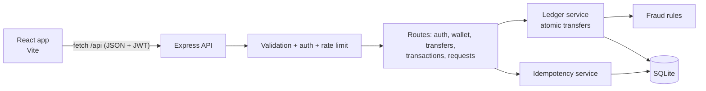

# MiniPay

A full-stack mock peer-to-peer payments app. Users sign up, add **test money** to a wallet, send money to each other, request money, and review a transaction history. No real money or card data is ever involved.

**Live demo:** Not deployed yet · **API health check:** Not deployed yet

## Screenshots

| Sign in | Wallet |
|---|---|
|  |  |

| Activity | Requests |
|---|---|
|  |  |

## What it demonstrates

| Area | What is implemented |
|---|---|
| **REST API** | Express API with JWT authentication, input validation (zod), consistent JSON errors, rate limiting, security headers |
| **Correct money handling** | Integer paise (no floats), atomic debit + credit + ledger row in one database transaction, `CHECK (balance >= 0)` as a last line of defence |
| **Idempotency** | `Idempotency-Key` header on transfers: retries and double-clicks never send money twice |
| **Concurrency** | Tests fire 50 simultaneous transfers against one wallet and assert no overdraft and no lost or created money |
| **Fraud flags** | Three rules (large amount, large amount to a new recipient, many transfers in one minute) flag a transfer for review without blocking it |
| **SQL** | Relational schema with foreign keys, indexes, joins, filtering and pagination |
| **Frontend** | React app calling the API with `fetch`; forms, filters, paging, loading and error states, responsive, dark mode, keyboard accessible |
| **Testing and CI** | Jest + Supertest (backend), Vitest (frontend), GitHub Actions (API on Node 18, 20 and 22; web app on Node 22) |

## Architecture



### Data model

- `users`, `wallets` (one per user, balance in paise)
- `transactions` (ledger of top-ups and transfers, with fraud flag and reasons)
- `payment_requests` (pending, paid, declined, cancelled)
- `idempotency_keys` (saved responses keyed by user and key)

## How a transfer stays correct

1. The request needs an `Idempotency-Key` header (the React app generates one per user action).
2. In **one immediate transaction**, the server checks whether the key was seen. If so, it replays the saved response and stops.
3. Otherwise it runs `UPDATE wallets SET balance = balance - ? WHERE user_id = ? AND balance >= ?`. The balance check and the debit are a single statement, so there is no gap for another request to slip into. If no row changed, the transfer fails with `402 INSUFFICIENT_FUNDS`.
4. It credits the recipient, evaluates the fraud rules, writes the ledger row, and saves the response under the key.
5. Any error rolls back every step, including the key, so nothing is half-done and the user can safely retry.

## API

All endpoints are under `/api`. Errors look like `{ "error": { "code": "INSUFFICIENT_FUNDS", "message": "..." } }`. Amounts are integers in paise (`25000` = 250.00).

| Method | Path | Auth | Purpose |
|---|---|---|---|
| GET | `/health` | no | Health check |
| POST | `/auth/register` | no | Create account (`name`, `email`, `password`) |
| POST | `/auth/login` | no | Get a JWT |
| GET | `/auth/me` | yes | Current user |
| GET | `/wallet` | yes | Balance |
| POST | `/wallet/topup` | yes | Add test money (`amountMinor`) |
| POST | `/transfers` | yes | Send money (`toEmail`, `amountMinor`, `note`). **Requires `Idempotency-Key` header** |
| GET | `/transactions` | yes | History. Query: `type`, `direction`, `flagged`, `limit`, `offset` |
| POST | `/requests` | yes | Ask a user for money (`fromEmail`, `amountMinor`, `note`) |
| GET | `/requests?box=incoming\|outgoing` | yes | List requests |
| POST | `/requests/:id/pay` · `/decline` · `/cancel` | yes | Resolve a request |

Example:

```bash
curl -X POST http://localhost:4000/api/transfers \
  -H "Authorization: Bearer $TOKEN" \
  -H "Content-Type: application/json" \
  -H "Idempotency-Key: 3f2c9d1e-7a4b-4c1e-9a55-0d1e2f3a4b5c" \
  -d '{"toEmail":"rahul@example.com","amountMinor":25000,"note":"dinner"}'
```

Sending the same request again returns the same response with the header `Idempotent-Replayed: true` and moves no money.

## Run it locally

Requires Node 22.12 or newer for the web app (the API alone runs on Node 18+).

```bash
# 1. API (http://localhost:4000)
cd backend
cp .env.example .env
npm install
npm run seed      # optional: creates asha@, rahul@, meera@example.com (password: password123)
npm run dev

# 2. Web app (http://localhost:5173), in a second terminal
cd frontend
npm install
npm run dev
```

The dev server proxies `/api` to the backend, so no extra configuration is needed.

### Run the tests

```bash
cd backend && npm test      # Jest + Supertest
cd frontend && npm test     # Vitest
```

## Deploy

**API on Render:** create a Web Service from this repo (or use `render.yaml`), root directory `backend`, build `npm ci`, start `npm start`. Set `CORS_ORIGIN` to your frontend URL. `JWT_SECRET` is generated for you.

**Web app on Vercel:** import the repo, set the root directory to `frontend`, and add the environment variable `VITE_API_URL` with your Render URL (no trailing slash).

> **Note:** the free Render tier has an ephemeral filesystem, so the SQLite file resets when the service restarts or redeploys. That is fine for a demo (run the seed script, or sign up again). For persistent data, attach a disk or move to PostgreSQL (see below).

## Design decisions and trade-offs

- **Integer money.** Floats cannot represent most decimal amounts exactly, so all amounts are whole paise end to end, and the UI parses text directly to integers.
- **SQLite for simplicity.** It keeps the project runnable with zero setup. better-sqlite3 runs one write transaction at a time, which makes the atomic-transfer logic easy to reason about. The concurrency tests prove the invariants (no overdraft, money conserved), but because Node and SQLite are single-writer here, they do not prove behaviour under a multi-writer database.
- **Moving to PostgreSQL.** The SQL is standard. The conditional `UPDATE ... WHERE balance >= ?` pattern works as is under `READ COMMITTED`. For multi-statement logic, lock rows with `SELECT ... FOR UPDATE` (taking locks in a fixed order, such as lowest user id first, to avoid deadlocks) and store idempotency keys with a unique constraint.
- **Fraud rules flag, they do not block.** Blocking legitimate payments is costly. Flags are visible to the sender only, and thresholds live in `backend/src/config.js`.
- **Failed requests do not consume idempotency keys.** Only completed requests are saved, so a user can retry after fixing the cause (for example, topping up after "insufficient funds") with the same key.

## Limitations and next steps

- No email verification, password reset or refresh tokens (the JWT lasts 2 hours).
- Single currency (INR) and no currency conversion.
- Fraud thresholds are static. A next step is per-user baselines (for example, flag amounts far above a user's median).
- Add pagination cursors, structured logging, and an OpenAPI spec.

## Project structure

```
backend/
  src/
    app.js, server.js, config.js, db.js, seed.js
    routes/       auth, wallet, transfers, transactions, requests
    services/     ledger (atomic transfers), idempotency, fraud
    middleware/   auth, rateLimit, errorHandler
  tests/          auth, transfers + idempotency + concurrency, fraud, history + requests
frontend/
  src/
    App.jsx, api.js, money.js
    views/        Auth, Wallet, Activity, Requests
    components/   Ledger, Notice
.github/workflows/ci.yml
render.yaml
```

## License

MIT
